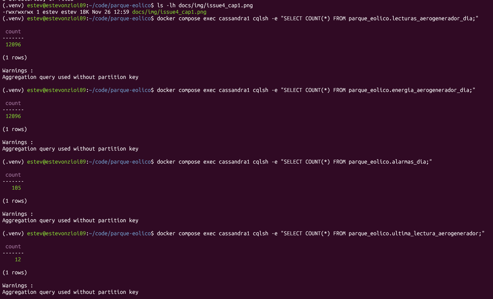
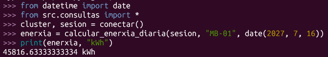
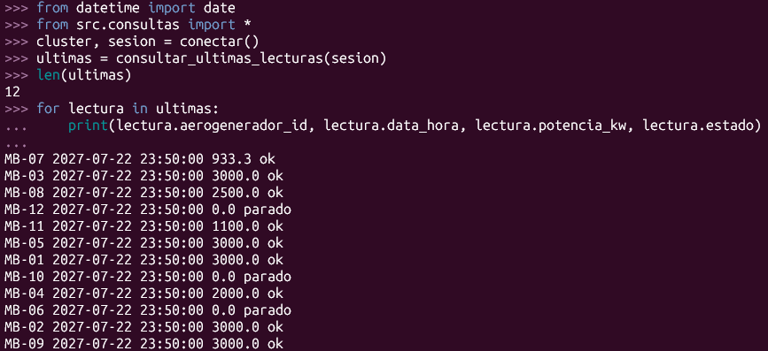

# Issue 1 – Configuración do clúster Cassandra

## 1. Obxectivo

Configurar un clúster Cassandra 4.1 con tres nodos e un servizo Python, utilizando Docker Compose.

## 2. Configuración do clúster

O clúster está formado por tres nodos:

- `cassandra1`
- `cassandra2`
- `cassandra3`

Os tres pertencen ao clúster `ParqueEolicoCluster` e ao centro de datos `datacenter1`.

A comprobación con `nodetool status` permite verificar que os tres nodos están activos (`UN`).

## 3. Creación do keyspace

Creouse o keyspace `parque_eolico` mediante o ficheiro `cql/schema.cql`, utilizando:

- Estratexia de replicación: `NetworkTopologyStrategy`.
- Factor de replicación: `3`.
- Centro de datos: `datacenter1`.

A configuración comprobouse mediante `DESCRIBE KEYSPACE parque_eolico`.

## 4. Proba de datos

Mediante o ficheiro `cql/test_persistence.cql` creouse a táboa `test_persistencia` e inseriuse un rexistro de proba.

A consulta `SELECT` confirmou que o dato foi almacenado e recuperado correctamente.

## 5. Contedores Docker

Comprobouse que os servizos do proxecto están en execución mediante `docker compose ps`.

## 6. Conclusión

A configuración permite executar un clúster Cassandra de tres nodos, cun keyspace replicado nos tres nodos e unha táboa na que se poden inserir e consultar datos.

# 2. Deseño do modelo de datos

Deseñáronse catro táboas en Cassandra, cada unha orientada a unha consulta:

- `lecturas_aerogenerador_dia`: almacena as lecturas completas de cada aeroxerador por día.
- `energia_aerogenerador_dia`: almacena os datos de potencia necesarios para calcular a enerxía diaria.
- `alarmas_dia`: almacena unicamente as lecturas en estado de alarma.
- `ultima_lectura_aerogenerador`: conserva a última lectura de cada aeroxerador.

As táboas de lecturas e enerxía comparten parte da información. Esta duplicación é intencionada e responde ao modelo de deseño de Cassandra, no que as táboas se adaptan ás consultas que deben resolver. Así evítase recuperar información innecesaria e mellórase a eficiencia das lecturas.

# 3. Carga de datos e consultas

Implementáronse scripts Python para cargar en Cassandra as lecturas xeradas no ficheiro CSV e executar as consultas necesarias para a monitorización do parque.

A carga inclúe a conversión dos tipos de datos e a inserción dos rexistros nas táboas correspondentes, actualizando tamén a última lectura de cada aeroxerador.

As consultas permiten recuperar as lecturas por día, calcular a enerxía producida, consultar as alarmas e obter a última lectura de cada aeroxerador.

A enerxía diaria calcúlase sumando a potencia de cada intervalo de dez minutos multiplicada por \(10/60\), obtendo o resultado en kWh.

# 4. Probas e conclusión

Realizáronse comprobacións para verificar a correcta carga dos datos, o funcionamento das consultas, o cálculo da enerxía e o almacenamento das alarmas e das últimas lecturas.

O sistema permite almacenar e consultar de forma distribuída a información dos aeroxeradores mediante un clúster Cassandra de tres nodos.

## Consultas a Cassandra

O ficheiro `src/consultas.py` contén as funcións necesarias para conectarse ao clúster Cassandra e realizar consultas sobre os datos almacenados no keyspace `parque_eolico`.

A función `conectar()` establece a conexión co clúster a través do porto 9042 e selecciona o keyspace do proxecto. Devolve o obxecto do clúster e a sesión, que se empregará para executar as consultas CQL.

O ficheiro tamén incluirá as funcións correspondentes ás catro consultas principais do proxecto:

- **Lecturas por aeroxerador e día:** recuperar as medicións dun aeroxerador nunha data determinada.
- **Enerxía diaria:** calcular a enerxía producida por un aeroxerador ao longo dun día a partir das lecturas de potencia.
- **Alarmas por día:** consultar os rexistros que presentan estado de alarma nunha data determinada.
- **Última lectura:** recuperar a medición máis recente de cada aeroxerador.

### Cálculo da enerxía diaria

A función `calcular_enerxia_diaria()` calcula a enerxía total producida por un aeroxerador nun día. Para iso, consulta as lecturas de potencia almacenadas en Cassandra e suma a enerxía correspondente a cada intervalo de 10 minutos.

Cada lectura de potencia (kW) multiplícase por \(10/60\) horas, obtendo a enerxía en kWh. Finalmente, acumúlanse os resultados para obter a produción enerxética diaria.

### Consulta de alarmas diarias

A función `consultar_alarmas_diarias()` permite recuperar todas as alarmas rexistradas nun día concreto. Consulta a táboa `alarmas_dia` e devolve os rexistros ordenados cronoloxicamente.

### Consulta das últimas lecturas

A función `consultar_ultimas_lecturas()` recupera a última lectura almacenada de cada aeroxerador. Para iso, consulta a táboa `ultima_lectura_aerogenerador`, que mantén un rexistro actualizado por cada máquina.

### Carga de datos en Cassandra

Executouse o script `carga.py` para importar as lecturas do ficheiro CSV nas catro táboas de Cassandra. A carga completouse correctamente, procesando 12.096 lecturas, inserindo 105 alarmas e actualizando os rexistros dos 12 aeroxeradores.

Comprobouse tamén que o número de rexistros almacenados coincide co esperado: 12.096 en `lecturas_aerogenerador_dia`, 12.096 en `energia_aerogenerador_dia`, 105 en `alarmas_dia` e 12 en `ultima_lectura_aerogenerador`.

### Consulta de lecturas dun aeroxerador

A función `consultar_lecturas_aeroxerador()` recupera todas as lecturas dun aeroxerador nun día determinado, ordenadas da máis recente á máis antiga. Comprobouse o seu funcionamento con MB-01 o 16/07/2027, obtendo as 144 lecturas esperadas.

### Comprobación do cálculo da enerxía diaria

Probouse a función `calcular_enerxia_diaria()` con MB-01 o 16/07/2027, obtendo unha produción diaria de **45.816,63 kWh**.

### Comprobación das alarmas diarias

Verificouse a consulta de alarmas para o 16/07/2027. Recuperáronse 12 rexistros, todos co estado `alarma` e ordenados cronoloxicamente.

### Comprobación das últimas lecturas

Finalmente, comprobouse que a función `consultar_ultimas_lecturas()` devolve unha lectura por cada un dos 12 aeroxeradores. Todas corresponden ao último intervalo rexistrado, o 22/07/2027 ás 23:50.

# Issue 3 – Modelos de Cassandra

## Diseño del modelo de datos en Cassandra

### 1. Justificación de las claves de partición y las columnas de agrupación

El modelo de datos se ha diseñado teniendo en cuenta las consultas que se necesitan realizar sobre la información del parque eólico. En Cassandra, la clave de partición determina cómo se distribuyen los datos entre los nodos, mientras que las columnas de agrupación permiten ordenar e identificar las filas dentro de cada partición.

Se ha buscado que las particiones tengan un tamaño limitado, evitando que crezcan indefinidamente a medida que se generan nuevas lecturas.

#### Tabla `lecturas_aerogenerador_dia`

Esta tabla almacena todas las lecturas de cada aerogenerador, organizadas por día.

- **Clave de partición:** `(aerogenerador_id, dia)`.
- **Columna de agrupación:** `data_hora`, ordenada de forma descendente (`DESC`).

La clave de partición combina el identificador del aerogenerador con el día de la lectura. De esta manera, cada aerogenerador tiene una partición diferente para cada día.

La columna `data_hora` permite ordenar cronológicamente las lecturas dentro de esa partición, mostrando primero las más recientes.

Según el contrato, cada aerogenerador genera una lectura cada 10 minutos, por lo que se almacenan 144 lecturas diarias por aerogenerador.

**Crecimiento de las particiones:** al cabo de un año, cada partición seguirá teniendo como máximo 144 filas, ya que cada día genera una partición nueva. Para los 12 aerogeneradores se crearán 4.380 particiones al año (12 × 365).

#### Tabla `energia_aerogenerador_dia`

Esta tabla almacena las lecturas de potencia necesarias para realizar consultas y calcular la energía generada por cada aerogenerador.

- **Clave de partición:** `(aerogenerador_id, dia)`.
- **Columna de agrupación:** `data_hora`.

Se utiliza la misma estrategia que en la tabla de lecturas: cada partición corresponde a un aerogenerador y a un día concreto.

Esta decisión permite consultar de forma independiente las potencias registradas por cada aerogenerador durante un día, sin tener que recorrer todas las lecturas del parque.

**Crecimiento de las particiones:** cada partición contiene 144 filas como máximo, una por cada intervalo de 10 minutos. En un año se generan también 4.380 particiones para el conjunto de los 12 aerogeneradores.

#### Tabla `alarmas_por_dia`

Esta tabla almacena únicamente las lecturas cuyo estado es de alarma.

- **Clave de partición:** `dia`.
- **Columnas de agrupación:** `data_hora` y `aerogenerador_id`.

La clave de partición es el día, de modo que todas las alarmas registradas durante una misma jornada quedan agrupadas en una partición.

Se utilizan dos columnas de agrupación porque varios aerogeneradores pueden generar una alarma en el mismo instante. `data_hora` identifica el momento de la lectura y `aerogenerador_id` permite distinguir qué aerogenerador ha generado la alarma.

Las filas se ordenan por fecha y hora de forma ascendente (`ASC`).

Según el generador, aproximadamente el 1 % de las lecturas tienen una temperatura de alarma. Como el parque genera 1.728 lecturas diarias, se esperan aproximadamente 17,28 lecturas con temperatura de alarma al día. El número de estados `alarma` puede ser algo inferior porque un aerogenerador parado no recibe ese estado, aunque tenga una temperatura elevada.

**Crecimiento de las particiones:** se espera almacenar aproximadamente 17 lecturas de alarma por partición y día. En un año se crearán 365 particiones. Como límite teórico, una partición podría llegar a contener las 1.728 lecturas del parque de un día si todas fueran alarmas. En cualquier caso, la partición queda limitada a un único día y no acumula las alarmas de todo el año.

#### Tabla `ultima_lectura_aerogenerador`

Esta tabla almacena la última lectura conocida de cada aerogenerador.

- **Clave de partición:** `aerogenerador_id`.
- **Columnas de agrupación:** no tiene.

Cada aerogenerador dispone de una única fila, que se actualiza cuando llega una nueva lectura. De esta forma, se puede consultar rápidamente el último estado conocido de cualquier aerogenerador.

**Crecimiento de las particiones:** cada partición contiene una única fila por aerogenerador, independientemente del tiempo que lleve funcionando el parque. Por tanto, se mantienen 12 particiones con una fila cada una.

### 3. Conversión de los campos del contrato a tipos CQL

Los campos del contrato de datos se han convertido a tipos compatibles con Cassandra (CQL), teniendo en cuenta el tipo de información que almacena cada uno.

| Campo del contrato | Tipo CQL | Justificación |
|---|---|---|
| `aerogenerador_id` | `TEXT` | Almacena identificadores alfanuméricos como MB-01. |
| `data_hora` | `TIMESTAMP` | Representa la fecha y hora de cada lectura. |
| `vento_ms` | `DECIMAL` | Permite almacenar velocidades con decimales. |
| `direccion_graos` | `INT` | Almacena grados enteros entre 0 y 359. |
| `potencia_kw` | `DECIMAL` | Permite almacenar potencias con decimales. |
| `rotor_rpm` | `DECIMAL` | Permite almacenar revoluciones por minuto con decimales. |
| `temp_xerador_c` | `DECIMAL` | Permite almacenar temperaturas con decimales. |
| `estado` | `TEXT` | Almacena valores como `ok`, `alarma` y `parado`. |

Además, se incorpora el campo `dia`, de tipo `DATE`, que se obtiene a partir de `data_hora`. Este campo no forma parte del contrato original, sino que se deriva de la fecha de la lectura y se utiliza para organizar las particiones diarias.

No todas las tablas almacenan todos los campos del contrato. Cada una conserva únicamente los datos necesarios para responder a las consultas previstas. Por ejemplo, `energia_aerogenerador_dia` almacena la potencia y el momento de cada lectura, mientras que `ultima_lectura_aerogenerador` conserva los datos de la última lectura recibida.