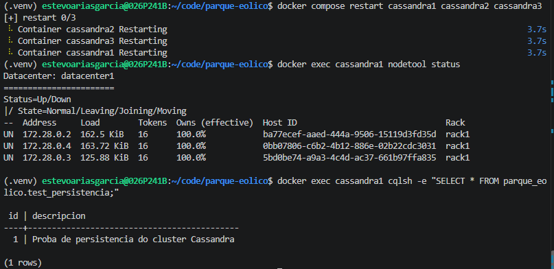

# Issue 1 – Configuración do clúster Cassandra

## 1. Obxectivo

Configurar un clúster Cassandra 4.1 con tres nodos e un servizo Python, utilizando Docker Compose.

## 2. Configuración do clúster

O clúster está formado por tres nodos:

- `cassandra1`
- `cassandra2`
- `cassandra3`

Os tres pertencen ao clúster `ParqueEolicoCluster` e ao centro de datos `datacenter1`.

A comprobación con `nodetool status` permite verificar que os tres nodos están activos (`UN`).

## 3. Creación do keyspace

Creouse o keyspace `parque_eolico` mediante o ficheiro `cql/schema.cql`, utilizando:

- Estratexia de replicación: `NetworkTopologyStrategy`.
- Factor de replicación: `3`.
- Centro de datos: `datacenter1`.

A configuración comprobouse mediante `DESCRIBE KEYSPACE parque_eolico`.

## 4. Proba de datos

Mediante o ficheiro `cql/test_persistence.cql` creouse a táboa `test_persistencia` e inseriuse un rexistro de proba.

A consulta `SELECT` confirmou que o dato foi almacenado e recuperado correctamente.

## 5. Contedores Docker

Comprobouse que os servizos do proxecto están en execución mediante `docker compose ps`.

## 6. Conclusión

A configuración permite executar un clúster Cassandra de tres nodos, cun keyspace replicado nos tres nodos e unha táboa na que se poden inserir e consultar datos.

# 2. Deseño do modelo de datos

Deseñáronse catro táboas en Cassandra, cada unha orientada a unha consulta:

- `lecturas_aerogenerador_dia`: almacena as lecturas completas de cada aeroxerador por día.
- `energia_aerogenerador_dia`: almacena os datos de potencia necesarios para calcular a enerxía diaria.
- `alarmas_dia`: almacena unicamente as lecturas en estado de alarma.
- `ultima_lectura_aerogenerador`: conserva a última lectura de cada aeroxerador.

As táboas de lecturas e enerxía comparten parte da información. Esta duplicación é intencionada e responde ao modelo de deseño de Cassandra, no que as táboas se adaptan ás consultas que deben resolver. Así evítase recuperar información innecesaria e mellórase a eficiencia das lecturas.

# 3. Carga de datos e consultas

Implementáronse scripts Python para cargar en Cassandra as lecturas xeradas no ficheiro CSV e executar as consultas necesarias para a monitorización do parque.

A carga inclúe a conversión dos tipos de datos e a inserción dos rexistros nas táboas correspondentes, actualizando tamén a última lectura de cada aeroxerador.

As consultas permiten recuperar as lecturas por día, calcular a enerxía producida, consultar as alarmas e obter a última lectura de cada aeroxerador.

A enerxía diaria calcúlase sumando a potencia de cada intervalo de dez minutos multiplicada por \(10/60\), obtendo o resultado en kWh.

# 4. Probas e conclusión

Realizáronse comprobacións para verificar a correcta carga dos datos, o funcionamento das consultas, o cálculo da enerxía e o almacenamento das alarmas e das últimas lecturas.

O sistema permite almacenar e consultar de forma distribuída a información dos aeroxeradores mediante un clúster Cassandra de tres nodos.