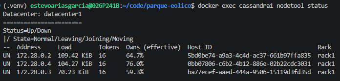
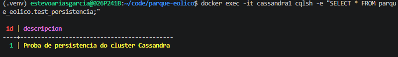
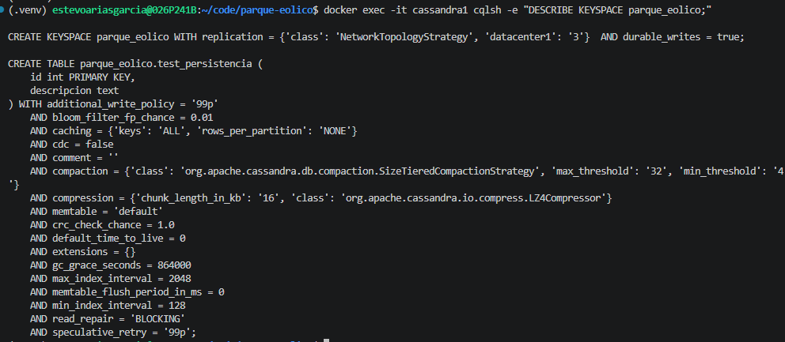
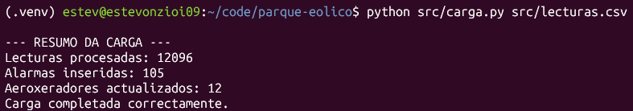
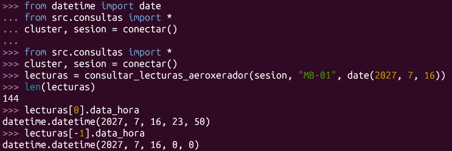
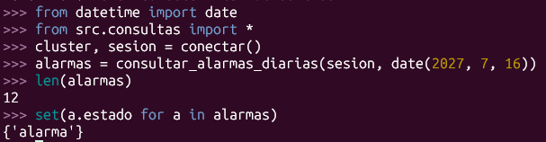

# Issue 1 – Configuración do clúster Cassandra

## 1. Obxectivo

Configurar un clúster Cassandra 4.1 con tres nodos e un servizo Python, utilizando Docker Compose.

## 2. Configuración do clúster

O clúster está formado por tres nodos:

- `cassandra1`
- `cassandra2`
- `cassandra3`

Os tres pertencen ao clúster `ParqueEolicoCluster` e ao centro de datos `datacenter1`.

A comprobación con `nodetool status` permite verificar que os tres nodos están activos (`UN`).

## 3. Creación do keyspace

Creouse o keyspace `parque_eolico` mediante o ficheiro `cql/schema.cql`, utilizando:

- Estratexia de replicación: `NetworkTopologyStrategy`.
- Factor de replicación: `3`.
- Centro de datos: `datacenter1`.

A configuración comprobouse mediante `DESCRIBE KEYSPACE parque_eolico`.

## 4. Proba de datos

Mediante o ficheiro `cql/test_persistence.cql` creouse a táboa `test_persistencia` e inseriuse un rexistro de proba.

A consulta `SELECT` confirmou que o dato foi almacenado e recuperado correctamente.

## 5. Contedores Docker

Comprobouse que os servizos do proxecto están en execución mediante `docker compose ps`.

## 6. Conclusión

A configuración permite executar un clúster Cassandra de tres nodos, cun keyspace replicado nos tres nodos e unha táboa na que se poden inserir e consultar datos.

# 2. Deseño do modelo de datos

Deseñáronse catro táboas en Cassandra, cada unha orientada a unha consulta:

- `lecturas_aerogenerador_dia`: almacena as lecturas completas de cada aeroxerador por día.
- `energia_aerogenerador_dia`: almacena os datos de potencia necesarios para calcular a enerxía diaria.
- `alarmas_dia`: almacena unicamente as lecturas en estado de alarma.
- `ultima_lectura_aerogenerador`: conserva a última lectura de cada aeroxerador.

As táboas de lecturas e enerxía comparten parte da información. Esta duplicación é intencionada e responde ao modelo de deseño de Cassandra, no que as táboas se adaptan ás consultas que deben resolver. Así evítase recuperar información innecesaria e mellórase a eficiencia das lecturas.

# 3. Carga de datos e consultas

Implementáronse scripts Python para cargar en Cassandra as lecturas xeradas no ficheiro CSV e executar as consultas necesarias para a monitorización do parque.

A carga inclúe a conversión dos tipos de datos e a inserción dos rexistros nas táboas correspondentes, actualizando tamén a última lectura de cada aeroxerador.

As consultas permiten recuperar as lecturas por día, calcular a enerxía producida, consultar as alarmas e obter a última lectura de cada aeroxerador.

A enerxía diaria calcúlase sumando a potencia de cada intervalo de dez minutos multiplicada por \(10/60\), obtendo o resultado en kWh.

# 4. Probas e conclusión

Realizáronse comprobacións para verificar a correcta carga dos datos, o funcionamento das consultas, o cálculo da enerxía e o almacenamento das alarmas e das últimas lecturas.

O sistema permite almacenar e consultar de forma distribuída a información dos aeroxeradores mediante un clúster Cassandra de tres nodos.

## Consultas a Cassandra

O ficheiro `src/consultas.py` contén as funcións necesarias para conectarse ao clúster Cassandra e realizar consultas sobre os datos almacenados no keyspace `parque_eolico`.

A función `conectar()` establece a conexión co clúster a través do porto 9042 e selecciona o keyspace do proxecto. Devolve o obxecto do clúster e a sesión, que se empregará para executar as consultas CQL.

O ficheiro tamén incluirá as funcións correspondentes ás catro consultas principais do proxecto:

- **Lecturas por aeroxerador e día:** recuperar as medicións dun aeroxerador nunha data determinada.
- **Enerxía diaria:** calcular a enerxía producida por un aeroxerador ao longo dun día a partir das lecturas de potencia.
- **Alarmas por día:** consultar os rexistros que presentan estado de alarma nunha data determinada.
- **Última lectura:** recuperar a medición máis recente de cada aeroxerador.

### Cálculo da enerxía diaria

A función `calcular_enerxia_diaria()` calcula a enerxía total producida por un aeroxerador nun día. Para iso, consulta as lecturas de potencia almacenadas en Cassandra e suma a enerxía correspondente a cada intervalo de 10 minutos.

Cada lectura de potencia (kW) multiplícase por \(10/60\) horas, obtendo a enerxía en kWh. Finalmente, acumúlanse os resultados para obter a produción enerxética diaria.

### Consulta de alarmas diarias

A función `consultar_alarmas_diarias()` permite recuperar todas as alarmas rexistradas nun día concreto. Consulta a táboa `alarmas_dia` e devolve os rexistros ordenados cronoloxicamente.

### Consulta das últimas lecturas

A función `consultar_ultimas_lecturas()` recupera a última lectura almacenada de cada aeroxerador. Para iso, consulta a táboa `ultima_lectura_aerogenerador`, que mantén un rexistro actualizado por cada máquina.

### Carga de datos en Cassandra

Executouse o script `carga.py` para importar as lecturas do ficheiro CSV nas catro táboas de Cassandra. A carga completouse correctamente, procesando 12.096 lecturas, inserindo 105 alarmas e actualizando os rexistros dos 12 aeroxeradores.

Comprobouse tamén que o número de rexistros almacenados coincide co esperado: 12.096 en `lecturas_aerogenerador_dia`, 12.096 en `energia_aerogenerador_dia`, 105 en `alarmas_dia` e 12 en `ultima_lectura_aerogenerador`.

### Consulta de lecturas dun aeroxerador

A función `consultar_lecturas_aeroxerador()` recupera todas as lecturas dun aeroxerador nun día determinado, ordenadas da máis recente á máis antiga. Comprobouse o seu funcionamento con MB-01 o 16/07/2027, obtendo as 144 lecturas esperadas.

### Comprobación do cálculo da enerxía diaria

Probouse a función `calcular_enerxia_diaria()` con MB-01 o 16/07/2027, obtendo unha produción diaria de **45.816,63 kWh**.

### Comprobación das alarmas diarias

Verificouse a consulta de alarmas para o 16/07/2027. Recuperáronse 12 rexistros, todos co estado `alarma` e ordenados cronoloxicamente.

### Comprobación das últimas lecturas

Finalmente, comprobouse que a función `consultar_ultimas_lecturas()` devolve unha lectura por cada un dos 12 aeroxeradores. Todas corresponden ao último intervalo rexistrado, o 22/07/2027 ás 23:50.

